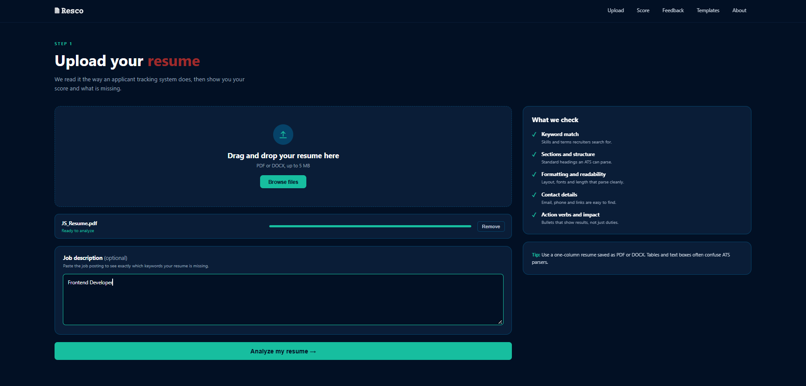

<<<<<<< HEAD
# Resco

**Know your ATS score before the recruiter does.**

Resco is a modern, frontend-only ATS resume checker UI built with React and Vite. Sign up, upload your resume, and see how applicant tracking systems would read it.

> Status: work in progress. The UI and flow are built; resume analysis and the backend are not connected yet.

## Features

- Sign-up page with a clean dark theme and a sample ATS score card
- Sticky navbar with smooth scrolling between sections (shown only after sign-up)
- Upload section with drag and drop and a Browse button
- File validation: PDF or DOCX only, up to 5 MB
- Optional job description box
- "What we check" panel: keyword match, sections, formatting, contact details, action verbs

## Tech Stack

- React
- Vite
- JavaScript
- CSS (Flexbox, conic-gradient, custom theme)
- HTML


## Getting Started

```bash
git clone https://github.com/Jaypal-coder/resco.git
cd resco
npm install
npm run dev
```

Then open `http://localhost:5173` in your browser.

## Screenshots

Add your screenshots here:

```md


```

## Roadmap

-  ATS score section with a result circle
-  Feedback and improvement suggestions
-  Resume templates
-  About section
-  Make the layout fully responsive
-  Connect a backend for real resume parsing

## Author

**Jaypal Solanki**
[GitHub](https://github.com/Jaypal-coder) | [LinkedIn](https://linkedin.com/in/jaypal-solanki-997039327)
=======
# React + Vite

This template provides a minimal setup to get React working in Vite with HMR and some Oxlint rules.

Currently, two official plugins are available:

- [@vitejs/plugin-react](https://github.com/vitejs/vite-plugin-react/blob/main/packages/plugin-react) uses [Oxc](https://oxc.rs)
- [@vitejs/plugin-react-swc](https://github.com/vitejs/vite-plugin-react/blob/main/packages/plugin-react-swc) uses [SWC](https://swc.rs/)

## React Compiler

The React Compiler is not enabled on this template because of its impact on dev & build performances. To add it, see [this documentation](https://react.dev/learn/react-compiler/installation).

## Expanding the Oxlint configuration

If you are developing a production application, we recommend using TypeScript with type-aware lint rules enabled. Check out the [TS template](https://github.com/vitejs/vite/tree/main/packages/create-vite/template-react-ts) for information on how to integrate TypeScript and Oxlint's TypeScript related rules in your project.
>>>>>>> 40ca966 (Add sign-up page and upload section)
